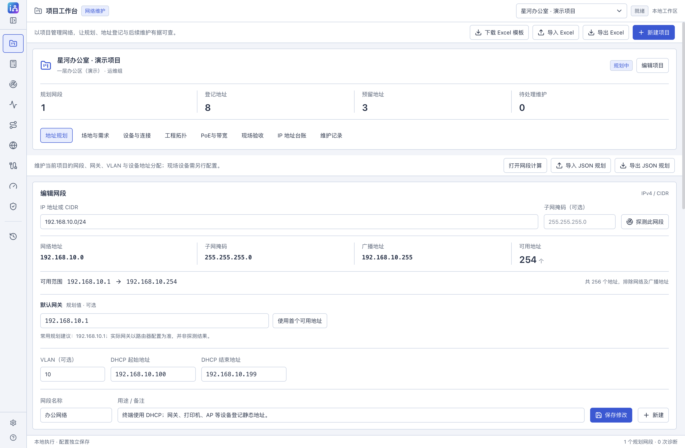
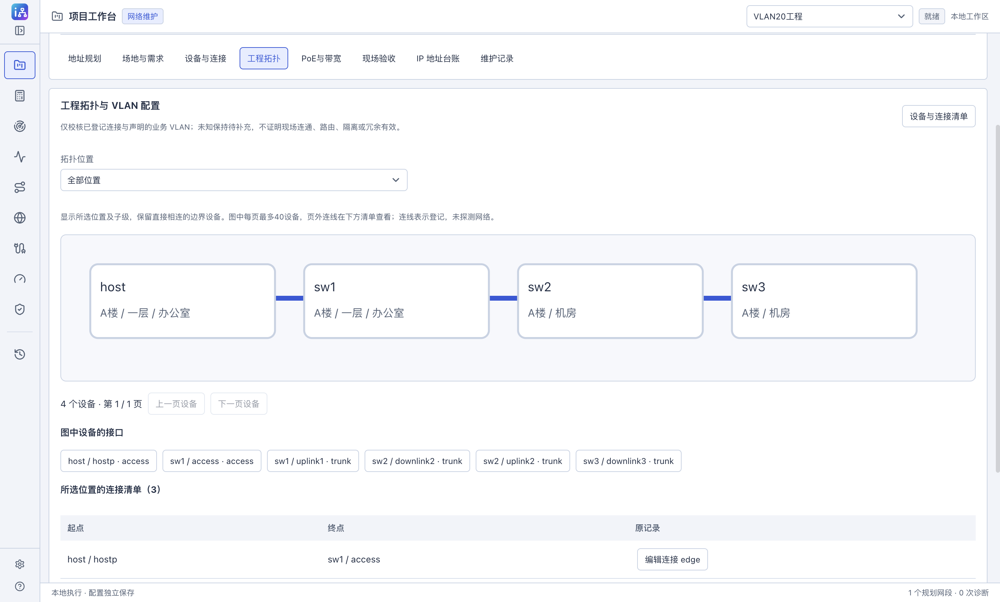

<p align="center"></p>

# Ineed NetTool

[简体中文](README.md) · English

**An open-source network toolbox for IP address management (IPAM), network planning and diagnostics.** Plan office and campus networks with IPv4 subnet/VLSM calculations, VLANs, registered topology, PoE and bandwidth capacity checks. Keep diagnostic evidence and acceptance records with the project, then export the engineering handover to Excel.

[Website](https://nettool.ineedfull.com/) · [Downloads](https://nettool.ineedfull.com/downloads/) · [GitHub](https://github.com/ineedfull/ineed-net-tool) · [Gitee](https://gitee.com/ineedfull/ineed-net-tool)

[](docs/images/readme/planning.webp)

## Plan a network and prepare the handover

1. **Record requirements:** organize buildings, floors and areas, wired/wireless access, access points and growth allowances.
2. **Plan addresses:** calculate IPv4 subnets and VLSM allocations; assign network ranges, VLANs, gateways and DHCP scopes.
3. **Document equipment and links:** register devices, ports and connections, generate the engineering topology, and check Access/Trunk and VLAN consistency.
4. **Check capacity:** review address and port capacity and estimate PoE load and uplink bandwidth from registered equipment.
5. **Record acceptance:** attach diagnostic evidence, track corrections and retests, and export project JSON or an engineering Excel workbook with 27 sheets.

The [engineering guide](docs/network-engineering.md), [topology guide](docs/engineering-topology.md), [capacity guide](docs/capacity-planning.md) and [site acceptance guide](docs/site-acceptance.md) describe these workflows.

## Diagnose everyday network problems

- IP address probing and an address ledger with table and compact grid views.
- Ping, DNS lookup and traceroute.
- TCP port checks, download speed tests and link quality measurements.
- TLS certificate inspection and project-associated diagnostic history.

Topology and capacity results depend on the registered data. NetTool does not automatically configure switches or firewalls. An address that does not respond to a probe is not proof that it is unused.

## Screenshots

These screenshots show the Chinese interface with isolated data in the Electron development application. See the [Chinese README](README.md#界面预览) for dates and more views. Click an image to enlarge it.

| IP address ledger | Engineering topology and VLAN checks |
| --- | --- |
| [](docs/images/readme/ledger.webp) | [](docs/images/readme/engineering-topology.webp) |

## Get started

Choose a desktop package from the [download page](https://nettool.ineedfull.com/downloads/), then create a blank project or start from an office, surveillance or multi-provider network template. Add requirements and subnets, register equipment and links, and run diagnostics against authorized targets. Record corrections and export the project for handover.

NetTool currently uses Vue and Electron. Electron bundles Chromium, so disk and memory usage are relatively larger. macOS has local verification; Windows/Linux build targets and their actual validation status are documented in the [packaging guide](docs/desktop-packaging.md). There is currently no Tauri implementation.

## Run from source

Use Node.js 22.16+ with `node:sqlite`, npm and the repository lockfile:

```sh
npm ci
npm start
```

`npm start` builds the renderer and starts the branded Electron host. `npm run dev` provides a browser preview with local planning; real network tasks and Excel import/export require the desktop application.

```sh
npm test
npm run build
npm run test:ui
```

UI tests start Electron. There is no `lint` script in this project. See the [development guide](docs/development.md) for prerequisites, and the [feature reference](docs/feature-reference.md) and [project guide](docs/network-projects.md) for product details. Detailed product guides are currently in Chinese.

## Contribute and license

See [CONTRIBUTING](CONTRIBUTING.md), the [code of conduct](CODE_OF_CONDUCT.md) and [security reporting](SECURITY.md). Include the OS, version and reproduction steps in reports, and remove credentials and sensitive network data.

Original project source is licensed under [Apache-2.0](LICENSE), except where another license is specified. See [NOTICE](NOTICE) and [third-party notices](THIRD_PARTY_NOTICES.md). Product names and logos are not licensed as trademarks by the source license. Contact: [xiaopanghhh@163.com](mailto:xiaopanghhh@163.com).

## More Ineed tools

| Tool | Purpose | Website | Source |
| --- | --- | --- | --- |
| MQTT Tool | MQTT client with independent JSON/Text/HEX views per subscription and message scenario tests | [Website](https://mqtt.ineedfull.com/) | [GitHub](https://github.com/ineedfull/ineed-mqtt-tool) · [Gitee](https://gitee.com/ineedfull/ineed-mqtt-tool) |
| LinkLab | Serial and industrial protocol testing, simulators and device acceptance | [Website](https://linklab.ineedfull.com/) | [GitHub](https://github.com/ineedfull/ineed-linklab) · [Gitee](https://gitee.com/ineedfull/ineed-linklab) |
| NetTool | IP address management, network planning, diagnostics and project handover | [Website](https://nettool.ineedfull.com/) | [GitHub](https://github.com/ineedfull/ineed-net-tool) · [Gitee](https://gitee.com/ineedfull/ineed-net-tool) |
| StorageLab | MinIO/S3 and multi-provider object storage management with directory verification | [Website](https://storagelab.ineedfull.com/) | [GitHub](https://github.com/ineedfull/ineed-storagelab) · [Gitee](https://gitee.com/ineedfull/ineed-storagelab) |

Ineed: [www.ineedfull.com](https://www.ineedfull.com/).
