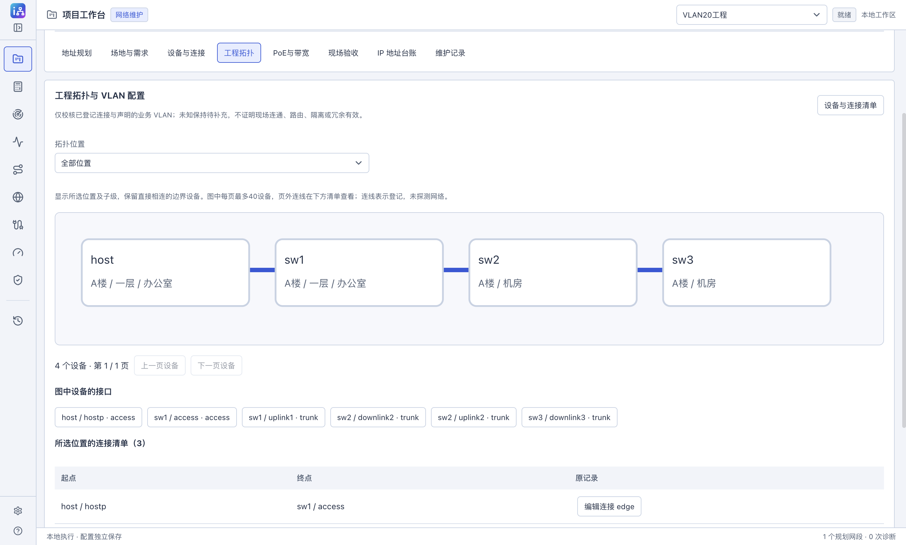
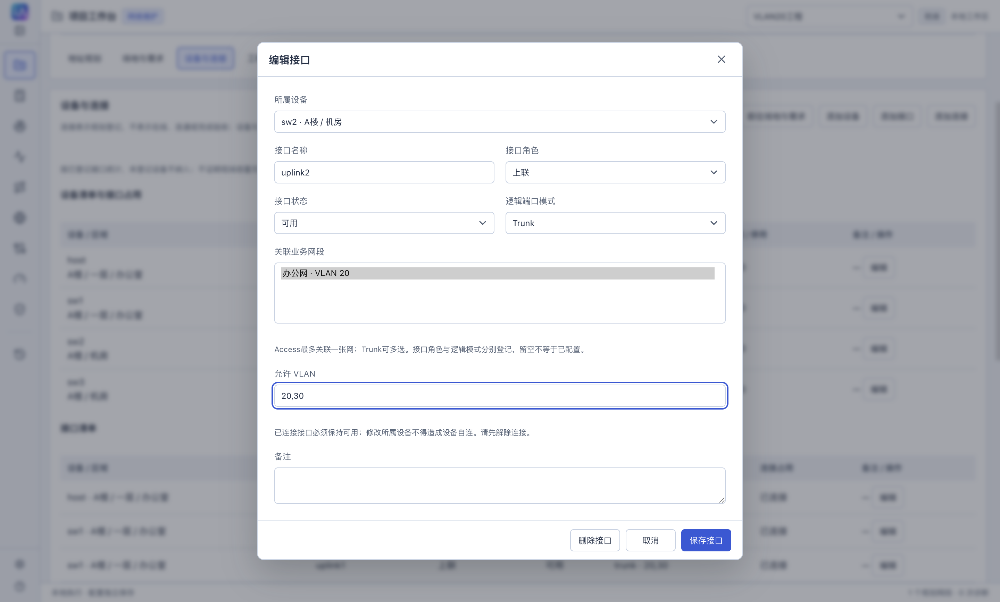

<p align="center"></p>

# Ineed NetTool

简体中文 · [English](README.en.md)

**开源网络工具箱与网络工程规划软件。** 面向企业办公室、园区和工程现场，提供 IP 地址管理（IPAM）、IPv4 子网/VLSM 计算、VLAN 与拓扑规划、Ping/DNS/路由跟踪及端口诊断。把场地需求、设备连接、容量校核和验收证据放进同一个项目，让规划资料能继续用于交付与维护。

[产品官网](https://nettool.ineedfull.com/) · [下载安装](https://nettool.ineedfull.com/downloads/) · [工程规划](docs/network-engineering.md) · [开发指南](docs/development.md) · [快速上手](docs/quick-start.md)

[](docs/images/readme/planning.webp)

## 一条完整的工程工作流

1. **整理现场需求**：按楼栋、楼层和区域记录有线、无线、AP 与增长预留。
2. **完成地址规划**：计算 IPv4 子网、按设备数量 VLSM 划分，分配网段、VLAN、网关和 DHCP 范围。
3. **登记设备与连接**：维护设备、接口与链路，从登记资料生成工程拓扑，检查 Access / Trunk 与业务 VLAN 的一致性。
4. **核对容量**：校核地址与端口容量，估算已登记设备的 PoE 负载和上联带宽，保留未知项供现场补齐。
5. **验收与交付**：关联诊断证据，记录整改与复验，导出项目 JSON 或 27 表工程 Excel。

## 日常排查也能用

IP 地址探测、Ping、DNS、路由跟踪、TCP 端口、下载测速、链路质量与 TLS 证书检查；诊断历史按项目保留，IP 台账支持表格与紧凑网格。

工程拓扑来自登记资料，容量结果来自已填参数。规划不会自动配置现场交换机或防火墙；探测无响应也不代表地址空闲。

## 界面预览

基础界面采集于 2026-11-02，拓扑与接口界面采集于 2026-11-01，均为隔离数据的 Electron 原生开发宿主。Ping 示例仅对本机回环地址运行。点击图片查看原图。

| IP 台账与地址用途 | 工程拓扑与 VLAN 校核 |
| --- | --- |
| [](docs/images/readme/ledger.webp) | [](docs/images/readme/engineering-topology.webp) |

| 接口 Access / Trunk 参数 | 多运营商与内外网规划 |
| --- | --- |
| [](docs/images/readme/logical-config.webp) | [](docs/images/readme/enterprise.webp) |


本机 Ping 结果与时延观察：

[](docs/images/readme/ping.webp)

## 开始使用

本轮测试版：`0.1.1`，调整范围见[版本说明](docs/releases/2026-11-20.md)。已可下载的文件及构建标识以官网下载页为准。

第一次使用？先按[快速上手](docs/quick-start.md)完成一个小练习，里面列出了示例参数、成功判断和常见问题排查。

新建项目，选择空白项目或办公室、监控、三运营商双网等模板。先登记需求与网段，再完善设备、接口和链路；完成诊断后将需要处理的问题转入现场验收，最终导出交付资料。

当前为 Vue + Electron 桌面应用。Electron 自带 Chromium，内存与磁盘占用相对较大。macOS 已有本机验收，Windows/Linux 的构建目标与实机验证状态见[打包说明](docs/desktop-packaging.md)，当前没有 Tauri 版本。

## 从源码运行

需要带 `node:sqlite` 的 Node.js 22.16+。在仓库根目录执行：

```sh
npm ci
npm start
```

`npm start` 先构建再启动品牌 Electron 宿主；`npm run dev` 仅启动浏览器预览，支持本地规划，真实网络任务和 Excel 导入导出需要桌面版。

```sh
npm test
npm run build
npm run test:ui
```

UI 测试会启动 Electron；本项目没有 `lint` 脚本。开发、数据备份和测试前提见[开发指南](docs/development.md)。

## 文档导航

| 想了解什么 | 入口 |
| --- | --- |
| 项目、IP 台账与 Excel | [项目指南](docs/network-projects.md)、[完整功能参考](docs/feature-reference.md) |
| 场地需求与地址容量 | [工程规划](docs/network-engineering.md) |
| 拓扑、接口与 VLAN | [工程拓扑](docs/engineering-topology.md) |
| PoE、带宽与现场交付 | [容量规划](docs/capacity-planning.md)、[现场验收](docs/site-acceptance.md) |
| 源码与界面规则 | [阅读地图](docs/code-reading-map.md)、[桌面 UI](docs/ui-2026-09-21/README.md) |
| 构建与验收边界 | [桌面打包](docs/desktop-packaging.md)、[功能矩阵](docs/existing-features-acceptance.md) |

## 参与和许可

欢迎反馈问题、改进文档或提交代码，入口见[贡献指南](CONTRIBUTING.md)、[社区交流约定](CODE_OF_CONDUCT.md)与[安全报告](SECURITY.md)。

除文件或目录另有说明外，项目原创源码采用 [Apache License 2.0](LICENSE)，相关署名见 [NOTICE](NOTICE)。第三方组件、字体与供应商代码保留原许可，详见[第三方声明](THIRD_PARTY_NOTICES.md)。产品名称和 Logo 的商标权不随源码许可证授予。

## 官网与交流

产品官网：[nettool.ineedfull.com](https://nettool.ineedfull.com/)；Ineed 主站：[www.ineedfull.com](https://www.ineedfull.com/)。

使用中遇到问题，欢迎扫码加微信，添加时请备注「NetTool」。反馈时请附系统、版本、操作步骤，并隐藏密钥、令牌及现场敏感信息。

<a href="docs/images/readme/wechat-qr.png"></a>

也可以发邮件：[xiaopanghhh@163.com](mailto:xiaopanghhh@163.com)。

## 同系列开源工具

| 工具 | 主要用途 | 产品官网 | 源码 |
| --- | --- | --- | --- |
| MQTT Tool | MQTT 客户端、按订阅独立显示 JSON/Text/HEX、设备消息场景 | [官网](https://mqtt.ineedfull.com/) | [GitHub](https://github.com/ineedfull/ineed-mqtt-tool) · [Gitee](https://gitee.com/ineedfull/ineed-mqtt-tool) |
| LinkLab | 串口与工业协议联调、客户端/模拟服务端、设备验收 | [官网](https://linklab.ineedfull.com/) | [GitHub](https://github.com/ineedfull/ineed-linklab) · [Gitee](https://gitee.com/ineedfull/ineed-linklab) |
| NetTool | IP 地址管理、网络工程规划与诊断、现场交付 | [官网](https://nettool.ineedfull.com/) | [GitHub](https://github.com/ineedfull/ineed-net-tool) · [Gitee](https://gitee.com/ineedfull/ineed-net-tool) |
| StorageLab | MinIO/S3 与多厂商对象存储管理、目录交付校验 | [官网](https://storagelab.ineedfull.com/) | [GitHub](https://github.com/ineedfull/ineed-storagelab) · [Gitee](https://gitee.com/ineedfull/ineed-storagelab) |

Ineed 主站：[www.ineedfull.com](https://www.ineedfull.com/)。
