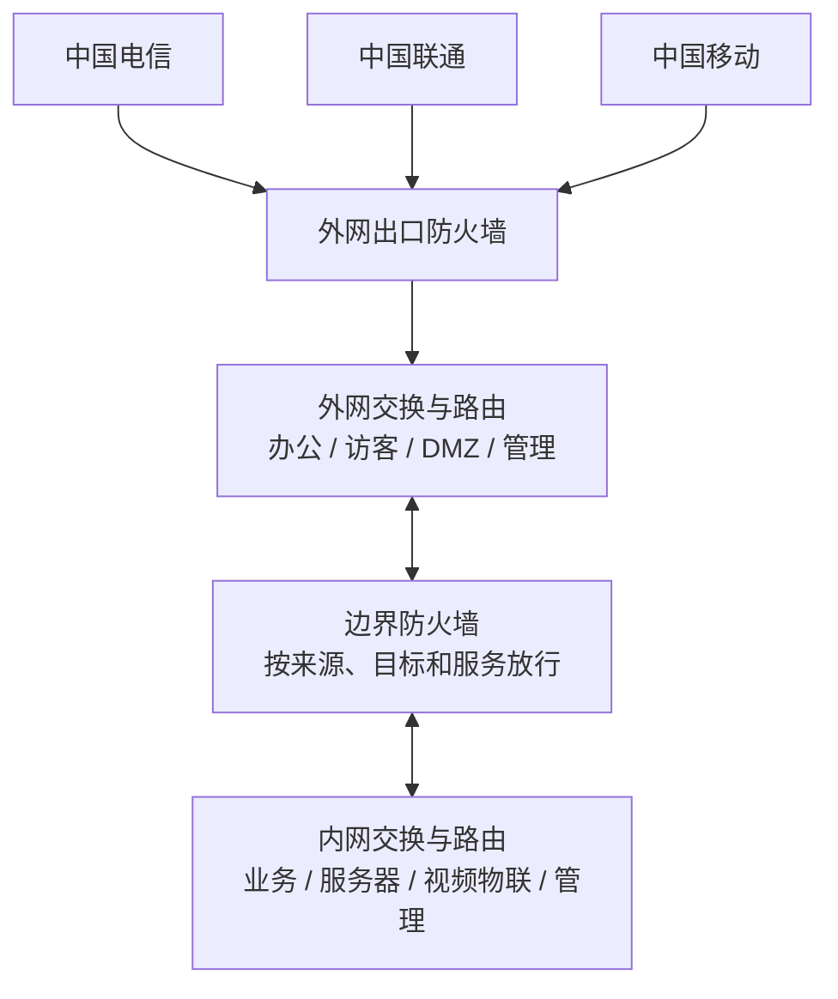
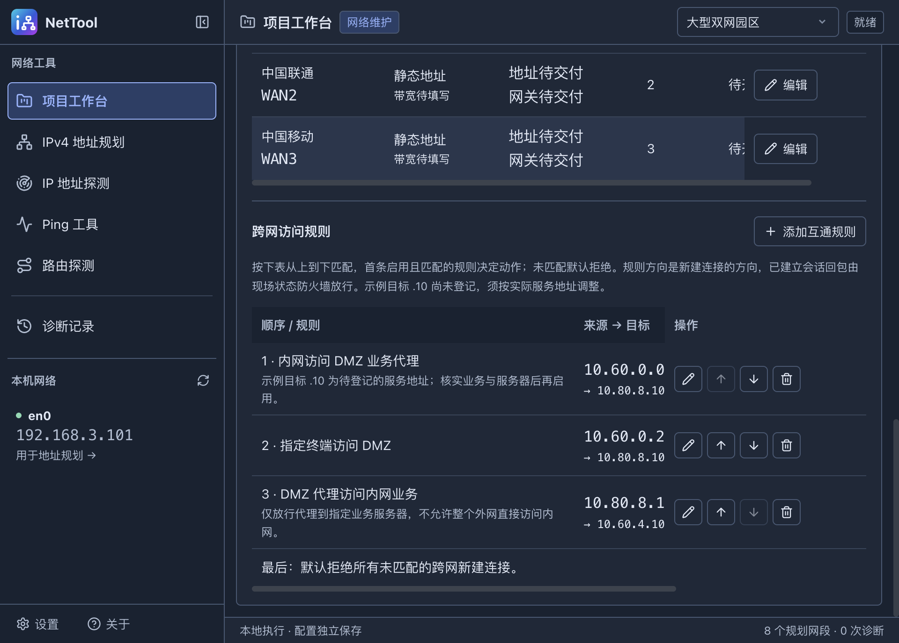

# 大型项目 · 三运营商双网

## 创建与拓扑

打开「项目工作台 → 新建项目 → 大型项目 · 三运营商双网」，分别填写内网、外网地址空间，创建前预览八个分区。地址空间必须完整位于私有地址范围、互不重叠且能容纳所有子网。

内网、外网各自使用独立的交换与路由体系。运营商线路统一接入外网出口防火墙；内外网之间通过边界防火墙建立受控三层通道，不直接桥接两个网络。VLAN 编号是规划信息，本身不能证明现场物理隔离。

默认分区如下，修改地址空间后会重新计算。只预留各网关，不生成已部署的终端或服务器。

| 分区           | CIDR          | VLAN | 用途                       |
| -------------- | ------------- | ---- | -------------------------- |
| 内网业务终端   | 10.60.0.0/22  | 110  | 内部业务终端，规划 DHCP    |
| 内网业务服务器 | 10.60.4.0/24  | 120  | 固定地址业务服务           |
| 内网视频与物联 | 10.60.8.0/22  | 130  | 按点位登记                 |
| 内网网络管理   | 10.60.12.0/24 | 199  | 内网设备管理               |
| 外网办公终端   | 10.80.0.0/22  | 210  | 互联网办公，规划 DHCP      |
| 外网访客无线   | 10.80.4.0/22  | 220  | 仅访问互联网，现场配置隔离 |
| 外网 DMZ 服务  | 10.80.8.0/24  | 230  | 对外服务与跨网代理         |
| 外网网络管理   | 10.80.9.0/24  | 299  | 外网设备管理               |

## 接入与互通

创建后打开「接入与互通」。三条运营商线路默认待开通，分别使用 WAN1 / WAN2 / WAN3；优先级 1 / 2 / 3，数字越小越优先。可登记带宽、静态 / DHCP / PPPoE 接入方式、运营商交付的 IPv4/CIDR、网关和备注，不预填虚构公网地址，不保存拨号密码。

线路状态为人工台账，不是自动链路监测；优先级为选路规划。实际健康检查、主备切换或负载分担、源 NAT 和回程选路需在出口设备配置，避免跨运营商出口回程不对称。边界防火墙还需要配置到内外网子网的双向路由。

跨网规则支持来源 / 目标 IPv4/CIDR、TCP / UDP / ICMP / 任意协议、目标端口、允许 / 拒绝、规划启停及说明。单台设备使用 `/32`，端口可填 `443,8000-8010`。可以添加、编辑、上移、下移与删除规则，规则来源与目标必须分属两张网络。

匹配约定是从上到下，首条启用且匹配的规则决定动作；未匹配默认拒绝。该方向描述新建连接方向，已建立会话回包由现场状态防火墙放行，不能把回包和反向主动访问混为一谈。

模板提供两条停用示例：内网业务终端访问 DMZ 的 TCP 443，以及 DMZ 代理访问指定内网服务器的 TCP 443。示例服务地址为对应子网的 `.10`，尚未登记为设备，需按实际部署修改。启用规划规则不会自动下发或开放现场网络。

网段与规则是各自保存的规划记录，后续调整具体业务子网或服务地址时，应同步检查对应规则。内外网根地址空间在创建时确定。

## 保存与交接

互联规划随项目保存在 SQLite，重启后恢复。项目 Excel 导出增加「互联架构」「运营商线路」「互通策略」三张表，保留规则顺序与启停状态；导入始终创建新项目。旧版五表文件仍可导入，普通项目不强制具有互联规划。

新版「下载 Excel 模板」在基础五表上动态增加三张互联规划表；它们可留空，有互联数据时需保留三张表，并在架构表填写一行内外网地址空间。

本地 macOS arm64 应用：`release/enterprise/mac-arm64/Ineed Net Tool.app`。本功能保存网络设计与台账，不会修改本机路由或远程设备配置。

## 验证结果

59 项自动化测试通过；最终 macOS arm64 包的 10 项桌面端到端测试全部通过。覆盖创建预览、重叠校验、线路编辑、规则增删与排序、项目隔离、Excel 导入导出、SQLite 重启恢复、浅色 / 深色大字模式与窄窗口布局。构建及本次修改文件格式检查通过。验证使用独立数据目录，未修改实际网络设备；跨平台真机验证仍单独进行。

## 操作列调整（2026-09-22）

运营商与规则表的操作列按按钮内容收紧宽度，表头和悬停背景与整行保持一致。编辑保留文字提示，上下排序合并为一组，删除独立显示。横向滚动时操作列仍固定在右侧。

本次构建、格式检查和大型项目桌面回归通过，打包后的同项回归也通过。新版 macOS arm64 应用：`release/action-columns/mac-arm64/Ineed Net Tool.app`。
