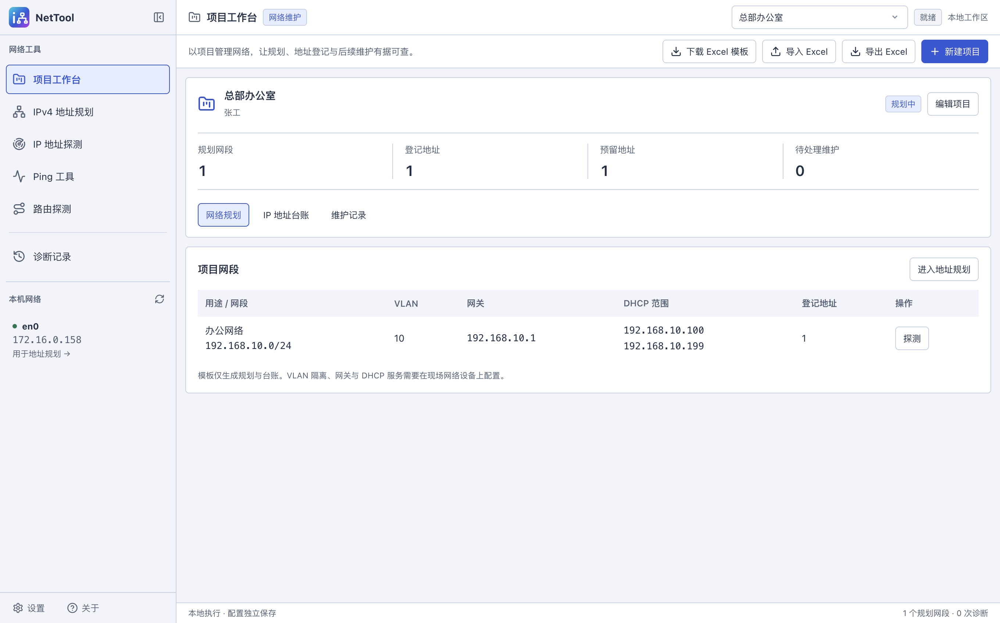
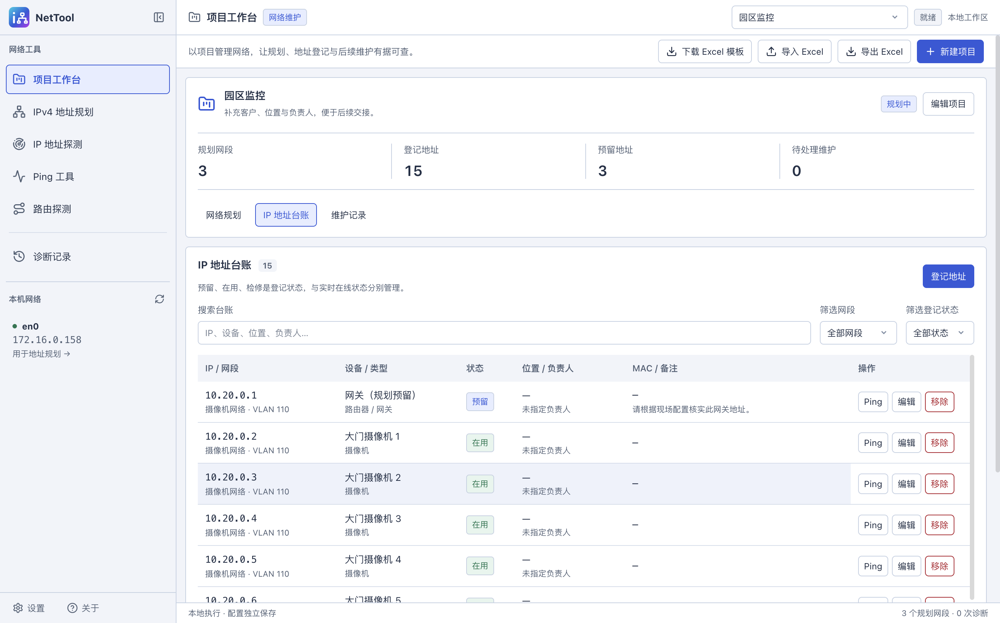

# 项目网络维护与 Excel 台账

NetTool 可按办公室、客户现场、监控工程分别管理网络。项目规划与登记状态由用户维护，扫描结果不会自动改写 IP 台账。该版本不自动配置交换机、VLAN、DHCP 或终端网卡。

## 从场景模板开始

打开「项目工作台 → 新建项目」，填写项目名称，可补充客户、现场位置、负责人、备注和项目状态。选择空白项目，或使用以下内置模板：

| 模板                    | 默认地址空间                             | 网段与用途                                                                                                     |
| ----------------------- | ---------------------------------------- | -------------------------------------------------------------------------------------------------------------- |
| 小型办公室              | `192.168.10.0/24`                        | 办公终端、打印机、AP 共用一个网段；VLAN 10，DHCP `.100`～`.199`                                                |
| 办公分区网络            | `10.10.0.0/22`                           | 办公、访客、服务器与打印、网络管理四个 `/24`；VLAN 10 / 20 / 30 / 99                                           |
| 大型项目 · 三运营商双网 | 内网 `10.60.0.0/16`、外网 `10.80.0.0/16` | 内外网独立地址规划、8 个业务分区、3 条线路及可编辑互通策略；见 [大型项目说明](enterprise-2026-09-21/README.md) |
| 视频监控                | `10.20.0.0/22`                           | 摄像机 `/23`、录像与存储 `/24`、监控管理 `/24`；VLAN 110 / 120 / 199                                           |

地址空间可以修改，必须完整位于 RFC1918 私有范围并足够容纳模板子网。创建前展示实际分配结果；创建后在「项目工作台 → 地址规划」中编辑网段、网关、VLAN 与 DHCP 起止地址。模板仅登记各网段的网关为「预留」，不会生成已部署设备。

顶部「当前项目」在侧栏展开和收起时都可使用。网段、台账、维护记录及诊断历史按项目展示。任务开始时绑定项目，运行或暂停期间不能切换项目；切换后清空上一项目的诊断视图并重置目标，防止把旧目标带入新项目。



## IP 地址登记

本页支持表格与紧凑网格。网格覆盖整个选中网段，可查看哪些 IP 已登记、预留、属于 DHCP 池、网关或可分配，并显示最近探测状态；默认方式可在设置中保存。详见 [IP 双视图说明](ip-views-2026-09-21/README.md)。

「项目工作台 → IP 地址台账」可以查看全项目；地址规划页选择已保存网段后，也可以维护该网段的登记记录。

- 字段包括 IP、设备名称、类型、状态、安装位置、负责人、MAC 与备注。
- 状态为「预留 / 在用 / 检修」，不表示实时在线或离线；设备类型支持终端、摄像机、NVR、交换机、路由器、AP、打印机、服务器及其他设备。
- 支持单条登记、编辑、移除，以及每次 1～128 条批量登记。批量设备名称自动附加序号，MAC 留空待逐台补充。
- 「建议空闲地址」与批量分配按可用地址从小到大查找，避开本项目相同 VLAN 的已登记地址、网关和 DHCP 池。这是台账空闲建议，不是网络占用检测。
- 相同项目、相同 VLAN 的重复 IP 会被拒绝，即使来自重叠网段。不同项目或不同 VLAN 可使用相同地址。VLAN 留空视为同一个未指定 VLAN 范围。
- 网络地址和广播地址不得登记；`/31` 和 `/32` 按 IPv4 规则处理。MAC 使用 `AA:BB:CC:DD:EE:FF`。
- 搜索可匹配 IP、名称、位置、负责人、MAC、备注、网段名称；支持网段与状态筛选。宽表格在表格区域内滚动，操作列固定在右侧。



## 维护记录

在项目的「维护记录」页添加日期、维护内容、负责人和待处理 / 已完成状态。可标记完成，也可重新打开。设备变更、线路更换、地址调整和待办巡检可随项目一起导出交接。

## Excel 模板与导入导出

桌面版项目工具栏提供「下载 Excel 模板」「导入 Excel」「导出 Excel」。一个工作簿对应一个项目，使用 `.xlsx`，文件上限 10 MB。导出当前项目的资料、全部网段、全部地址登记和维护记录，不受界面搜索或筛选影响，不包含诊断历史与外观设置。

新版下载和导出的工作簿由 25 张表组成；兼容旧版 5/8/12/16/21 表工作簿。下表列出最初的五张基础表；互联规划、场地工程、设备与连接（B1）及 PoE 与带宽（B2）扩展见后文。可选输入表无数据时可保持空白，校核表由应用根据登记输入生成：

| 工作表   | 字段                                                                            | 约定                                     |
| -------- | ------------------------------------------------------------------------------- | ---------------------------------------- |
| 填写说明 | 填写顺序、格式、示例处理与导入规则                                              | 模板版本 1                               |
| 项目     | 项目名称*、客户、现场位置、负责人、状态*、备注                                  | 只能填写一个项目；状态使用下拉选项       |
| 网段     | 网段编号*、网段名称*、CIDR*、VLAN、网关、DHCP起始、DHCP结束、备注               | 编号在工作簿中唯一，例如 `N001`          |
| IP台账   | 网段编号*、IP地址*、设备名称、设备类型*、状态*、安装位置、负责人、MAC地址、备注 | 用网段编号关联；设备名称可空，兼容旧登记 |
| 维护记录 | 日期*、维护内容*、负责人、状态*                                                 | 日期为 `yyyy-mm-dd`；待处理 / 已完成     |

另有「互联架构」（内外网 CIDR）、「运营商线路」（运营商、接口、带宽、接入、地址、网关、优先级、状态、备注）及「互通策略」（来源、目标、协议、端口、动作、规划状态、说明）三张可选表。规则按行顺序匹配；填写互联规划时保留这三张表，架构表只填一行。导入会校验地址空间隔离、规则方向与端口。

工程交接新增「场地位置」「业务需求」「接入容量」三张可选输入表与只读「容量校核」表。位置、需求与容量用工作簿内编号关联，需求网段沿用 N001 等编号。数量和可用端口留空表示待补充，0 表示明确零；增长填写 20 表示 20%。有工程输入时保留三张输入表；导入重新计算容量，忽略原校核表。填写说明中的“工程资料版本”保留启用但为空的工程资料。具体字段、限额与导入规则见[工程 Excel 契约](engineering-excel-contract.md)，使用流程见[场地与需求](network-engineering.md)。

带 `*` 的字段必填，请保留表名、第一行表头和列顺序。项目状态为「规划中 / 使用中 / 已归档」。IP、MAC 和网段编号使用文本单元格；VLAN 为数值，日期为日期单元格，也接受符合格式的日期文本。模板提供状态与设备类型下拉选项、冻结表头、列宽和中文示例。

填写步骤：

1. 下载模板，将示例项目和设备替换成现场资料，删除不用的示例行。填写一个项目，再填写网段、IP 台账和维护记录；后三张表可仅保留表头。
2. 选择「导入 Excel」。程序检查表头、必填值、编号关联、IP 范围、重复登记、DHCP 冲突、MAC 和日期。公式、链接或富文本单元格不能作为登记值，需先转换成普通值。
3. 校验失败会提示错误；逐行错误含表名和行号，最多展示前 50 项。此时没有任何项目数据被写入。
4. 校验成功后预览项目名称、网段、地址与维护数量。点击「确认导入为新项目」才会提交一个完整事务，并切换到新项目。

**导入始终创建独立的新项目，不按名称合并、不覆盖原项目。** 现有项目导出后在 Excel 中修改，再导入也会得到一份新项目；旧项目可改名或标记归档。网段编号只是工作簿内关联键，导出使用 `N001` 等编号，导入会生成新的内部 ID。

模板下拉预置到 IP 台账第 5001 行、网段 / 维护记录第 501 行；超出时可复制格式，应用仍执行完整校验。当前工作区最多 100 个项目、合计 500 个网段，每网段 4096 个地址，每项目 500 条维护记录；单个导入工作表最多 50000 行。批量登记或导入超过限制时整体拒绝，不部分写入。

基础五表模板为 `electron/templates/NetTool-网络项目模板.xlsx`。对外副本在 `outputs/nettool-projects-20260921/`；修改模板时同步这两份，并运行 Excel 测试。应用下载和导出时由 `templateWorkbook` / `projectWorkbook` 增补互联、工程和设备连接表，静态五表文件保留用于兼容旧版。字段规范来源为 `src/domain/excel-schema.js`。模板由 Artifact Tool 制作并逐表渲染检查；为兼容 ExcelJS，导出后的 SpreadsheetML 标签从 `x:` 前缀转换成等价的默认命名空间，内容与格式保持不变。

## SQLite 保存与备份

桌面数据保存在 Electron `userData` 下的 `workspace.sqlite`，macOS 默认路径：

```text
~/Library/Application Support/Ineed Net Tool/workspace.sqlite
```

数据库结构版本为 `PRAGMA user_version = 1`，工作区逻辑版本为 `2`。

| 表            | 保存内容                       | 关联                    |
| ------------- | ------------------------------ | ----------------------- |
| `meta`        | 工作区版本、外观设置、当前项目 | `key` 主键              |
| `projects`    | 项目资料与互联规划 JSON        | `id` 主键               |
| `networks`    | 网段资料 JSON                  | `project_id` 外键及索引 |
| `allocations` | 每条 IP 登记 JSON              | `network_id` 外键及索引 |
| `maintenance` | 每条维护记录 JSON              | `project_id` 外键及索引 |
| `history`     | 每次诊断任务 JSON              | `project_id` 外键及索引 |

项目、网段和子记录分别存行；业务字段由领域层统一校验。SQLite 外键、串行写入、`BEGIN IMMEDIATE`、WAL 及回滚保障一个操作整体保存。诊断历史保留所有项目合计最近 100 次任务；持续 Ping 明细最多 500 条，统计仍覆盖全部请求。

首次使用新版且数据库不存在时，自动读取同目录 `workspace.json`，将旧网段和历史归入「默认项目」，保存到 SQLite；旧 JSON 保持原样。后续以 SQLite 为准，不重新导入 JSON。无旧数据时创建空白默认项目。旧文件损坏、数据库损坏或版本未知时停止加载，保留原文件并显示错误，不以空数据覆盖。

完整备份请先退出应用，再复制整个用户数据目录。运行期间可能存在 `workspace.sqlite-wal` 和 `workspace.sqlite-shm`，不能只复制正在写入的主文件。Excel 是项目交接格式，不是整个工作区备份。浏览器预览仍使用独立 localStorage，首次保存旧版预览数据时保留 `ineed-net-tool-preview-v1-backup`，不会读写桌面数据库。

## 实现与验证

- `src/domain/projects.js`：项目、模板、地址作用域、批量分配、版本迁移与导入规则。
- `electron/store.cjs`：SQLite 初始化、迁移、装载、串行事务与恢复失败保护。
- `electron/excel.cjs`：模板下载、项目导出及只读导入校验；实际保存由确认后的工作区事务执行。
- `src/domain/engineering.js` / `electron/engineering-excel.cjs`：工程结构、区域/网段容量计算与工程工作簿输入/校核转换；工程数据随现有项目 JSON 保存，不变更 SQLite 表版本。
- `ProjectPanel.vue` / `AllocationPanel.vue`：项目工作台、Excel 预览、台账与维护界面；沿用同系列的弹窗、配色与字号。
- `tests/projects.test.js` / `tests/store.test.js` / `tests/excel.test.js`：领域规则、迁移、回滚、错误格式及 Excel 往返。
- `tests/ui/projects.spec.js`：真实 Electron 窗口完成模板建项目、IP 冲突、编辑、批量登记、维护、Excel 预览确认、诊断归属及重启恢复；文件选择器返回隔离测试路径，其余流程使用实际 IPC、ExcelJS 和 SQLite。

本期在 macOS arm64 验证，诊断仅使用回环地址，没有扫描用户局域网。Windows / Linux 尚需各平台真机验证。新版本地应用包为 `release/projects/mac-arm64/Ineed Net Tool.app`，保留相同应用 ID 和数据目录；正式分发签名、公证不属于本次交付。

## 工程设备、接口和连接（B1）

项目工作台“设备与连接”登记区域中的物理设备及接口，通过连接清单表达规划拓扑；“前往场地与需求”可补建区域。占用报告与手填容量分别展示，详见[工程规划](network-engineering.md)。

工程 JSON version 仍为 1，可选 `engineering.infrastructure` 的 version 为 1；旧项目缺省保持缺省，显式启用空清单可以保存。每项目上限 500 台设备、5000 个接口、2500 条连接，名称最多 100、型号 200、备注 1000、ID 100 字符。接口名在同设备内 trim 后唯一，所有引用属于当前项目，删除不静默级联。SQLite schema 1、workspace version 2、应用 ID 与数据路径不变。

B1 增加到十六表：原十二表加可选“工程设备”“设备接口”“接口连接”和派生“接口占用”。B2 扩展至二十一表，含 C 为二十五表，当前含 D 共二十七表，仍支持旧五/八/十二/十六表输入；静态五表模板不变。设备连接独立版本标记及严格输入规则见[工程 Excel 契约](engineering-excel-contract.md)。导入预览包括设备/接口/连接数量，确认后创建新项目，位置、设备、接口和连接 ID 全部重建并保持引用；导入失败不写入。

## PoE 与上联带宽（B2）

项目“PoE与带宽”分别维护整机预算、PoE负载、上联参数与业务项，支持新增、编辑和依赖保护删除，可前往设备与连接补充资料。可选 `engineering.infrastructure.capacityPlanning` version 1；未启用保持缺省，显式空计划可保存并往返。预算/负载/上联/业务上限分别为 500/2500/500/500，SQLite schema 1、workspace 2、engineering/infrastructure 1 以及数据路径均不变。

空数字保持未知，0 是明确零；新建表单预留/损耗/增长默认20%、并发100%，均可编辑且非实测。供电端与受电端由已登记连接选择并明确方向；上联保存连接端点快照，业务方向显示真实设备/区域/接口。保存失败保留表单草稿，重试成功才关闭；跨项目草稿隔离。删除已有引用不级联，需先处理相关校核记录。

B2 新增的五张容量表在当前二十七表工作簿中保留，导入预览显示四类校核数量；确认后创建新项目，重新生成所有记录和网段 ID，并重建连接两端、PoE供受电、上联快照与业务引用。结果表忽略并重算，错误不落盘。公式、限制、未知项与现场验收边界见[容量指南](capacity-planning.md)。

## 现场验收与交付（C）

项目工作台新增“现场验收”，可直接创建项目级检查项，按当前要求登记人工结论、保存当前项目诊断快照，并以明确的后续通过复验关联关闭整改。结果只追加，旧要求不参与当前通过统计，后续失败不会沿用旧通过。详见[现场验收指南](site-acceptance.md)。

C 扩展为25表时新增“验收清单”“验收结果”“整改复验”“现场验收报告”。预览展示检查、结果和整改数量；导入为新项目，重建目标、要求快照和复验引用，保留诊断来源 ID 作为出处。历史清理不会移除已复制证据，Excel 不包含原始诊断历史。旧 5/8/12/16/21/25 表仍兼容；缺省验收与显式空验收分别保留。

## 工程拓扑与 VLAN 配置交接

“工程拓扑”使用设备与连接的原记录生成图，按位置及子级筛选并显示直接边界设备。接口可选登记 Access/Trunk、关联业务网段和 VLAN；问题可建立人工现场验收检查。校核只覆盖登记连接段显式声明的业务，未知仍待补充，不证明现场连通或冗余有效。详见[拓扑与 VLAN 指南](engineering-topology.md)。

当前动态 Excel 在原25表后追加“端口逻辑配置”和只读“VLAN配置校核”，共27表；输入使用P接口编号和JSON列表中的N网段编号，独立版本标记为1/空。导入为新项目时所有业务网段引用重建；旧表与静态五表模板保留。字段与严格校验规则见[工程 Excel 契约](engineering-excel-contract.md)。
