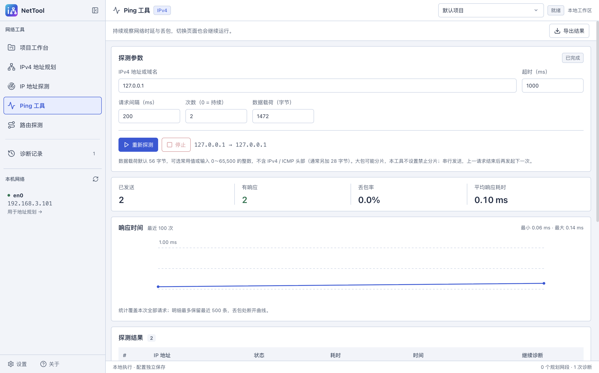
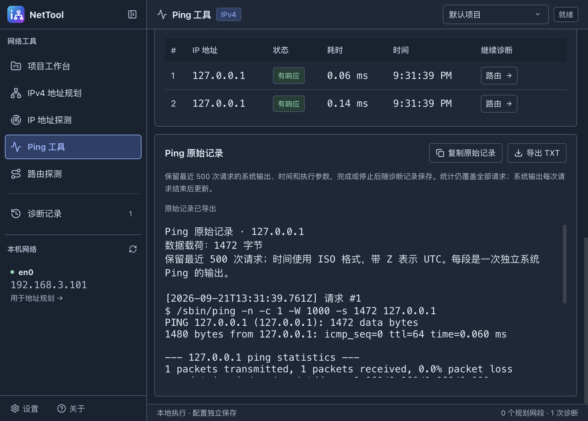

# Ping 包大小与原始记录

## 包大小

进入「Ping 工具」，在「数据载荷（字节）」中输入大小，或选择输入框的常用建议值：32、56、128、512、1024、1472。默认 56，支持 0～65,500 的整数。运行期间参数锁定，停止后可以调整并重新探测。

这里设置的是 ICMP 数据载荷，不包含协议头。普通 IPv4 + ICMP 头部另占 28 字节，例如 1472 字节载荷通常对应 1500 字节的 IPv4 报文。系统回应中显示的字节数可能包含 ICMP 头，因平台而异。大包可能发生分片；当前没有设置禁止分片，因此不能仅凭大包有响应就认定链路 MTU 足够大。

Windows 使用 `ping -l`，macOS / Linux 使用 `ping -s`；地址扫描继续使用系统默认包大小。

## 原始记录

Ping 页面下方的「Ping 原始记录」显示每次系统命令的输出，并支持复制及导出 UTF-8 TXT。包含请求序号、起止时间、实际命令参数、标准输出、标准错误、退出码，以及等待超时或用户停止标记。每次请求结束后更新，原始输出里的统计是该次系统 Ping 的统计；页面指标才是整个任务的统计。

任务完成、停止或执行失败后，原始记录随任务存入当前项目的 SQLite 诊断历史。进入「诊断记录 → 查看记录」可以再次查看、复制和导出；原有 JSON 导出也包含这些数据。旧历史若保存了原始输出，会直接展示，未记录的包大小不会按新版默认值补造。

每个任务保留最近 500 次请求的明细和原始输出，任务统计覆盖全部请求；工作区保留最近 100 个历史任务。诊断开始时间、Ping 明细、目标信息查询时间及原始记录的起止时间统一按本机时区显示为 `YYYY-MM-DD HH:mm:ss.SSS`（例如 `2026-09-22 14:08:36.125`），复制与 TXT 导出保持相同格式。底层保存及 JSON 导出仍使用带时区的 ISO 时间，不改写已有记录或系统原始输出。运行中的任务仍在内存，完成或停止后保存。

## 验证

55 项自动化测试、8 项桌面端到端测试通过，覆盖平台参数、非法大小拦截、真实回环 Ping、复制、TXT 导出、SQLite 重启恢复和深色大字模式。真实网络请求只对回环地址执行；Windows / Linux 命令分支有参数测试，尚未经真机验证。

打包后的 macOS arm64 应用已另外通过 Ping 包大小、复制、TXT 导出及重启恢复的端到端回归。

本地 macOS arm64 新包：`release/ping-output/mac-arm64/Ineed Net Tool.app`。
